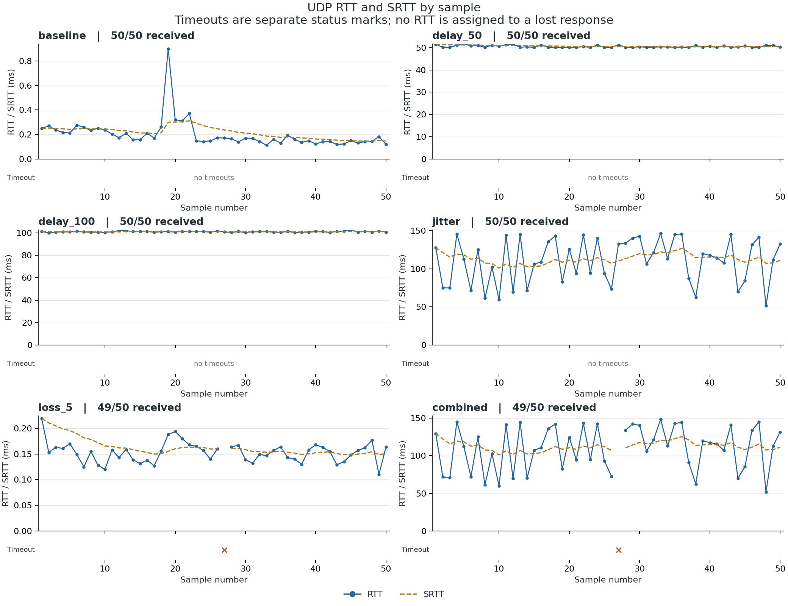
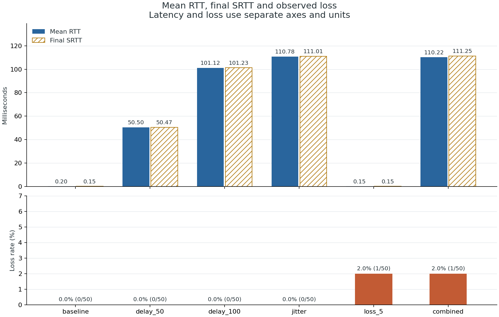
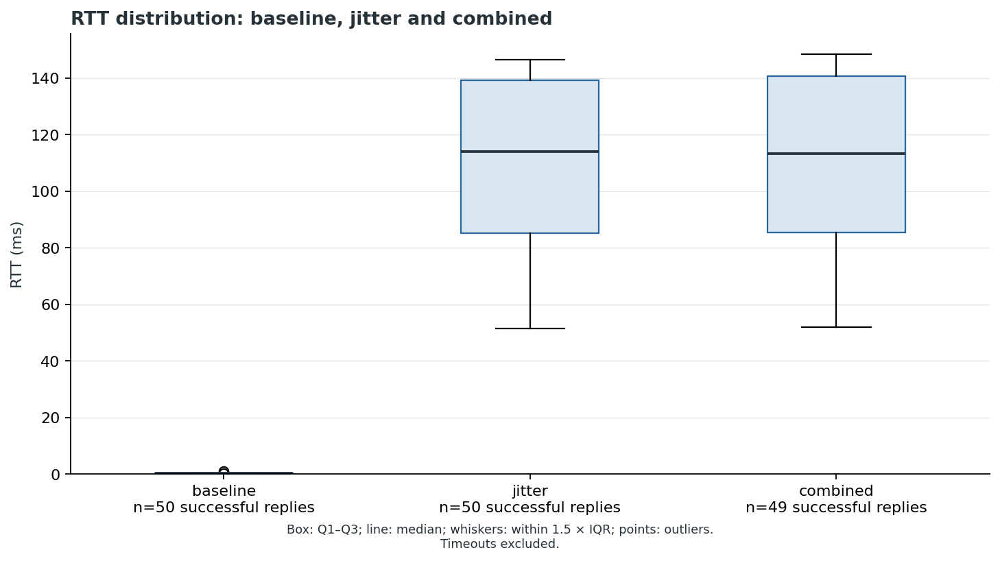

# Отчёт по измерению RTT

## Автор и происхождение

Артём Лаптев. Реализация подготовлена при помощи Codex. Исходный шаблон: [univ-mirea-iit/course-multiplayer](https://gitverse.ru/univ-mirea-iit/course-multiplayer). По выбору автора работа перенесена на GitHub с сохранением истории; межсервисной связи fork нет.

## Методика

Реальные UDP-датаграммы через loopback 127.0.0.1; шесть серий по 50 PING, интервал 200 мс, timeout 1000 мс, без повторных отправок. Задержка/джиттер и потеря PONG вводятся встроенным серверным эмулятором v1. Это дополнительная задержка обработки/ответа в одном направлении, поэтому delay_50 добавляет около 50 мс к RTT. Это не симуляция физического канала.

RTT вычисляется только по steady_clock клиента. Первое SRTT = RTT, далее SRTT = 0.875 × SRTT + 0.125 × RTT. В таблице показано последнее SRTT серии. Jitter = mean(|RTTᵢ − RTTᵢ₋₁|) для успешных ответов в порядке получения. Loss = timeouts / sent × 100%. Поздний ответ оставляет исходную потерю; дубликаты и ошибочные ответы не участвуют в RTT. Timeout при age ≥ 1000 мс. После завершения серия ещё 200 мс принимает диагностику.

## Результаты

| Серия | Sent | Received | Timeout | Min, мс | Mean, мс | Median, мс | Max, мс | SRTT, мс | Jitter, мс | Loss, % |
|---|---:|---:|---:|---:|---:|---:|---:|---:|---:|---:|---:|
| baseline | 50 | 50 | 0 | 0.113 | 0.200 | 0.170 | 0.900 | 0.147 | 0.055 | 0.000 |
| delay_50 | 50 | 50 | 0 | 50.088 | 50.500 | 50.230 | 51.585 | 50.471 | 0.452 | 0.000 |
| delay_100 | 50 | 50 | 0 | 100.157 | 101.122 | 101.166 | 102.645 | 101.229 | 0.570 | 0.000 |
| jitter | 50 | 50 | 0 | 51.443 | 110.777 | 113.995 | 146.460 | 111.007 | 37.697 | 0.000 |
| loss_5 | 50 | 49 | 1 | 0.110 | 0.153 | 0.156 | 0.219 | 0.151 | 0.017 | 2.000 |
| combined | 50 | 49 | 1 | 52.016 | 110.215 | 113.164 | 148.314 | 111.246 | 38.454 | 2.000 |

## Графики

## Анализ

Средний baseline RTT: 0.200 мс. При delay_50 средний RTT увеличился на 50.300 мс, при delay_100 — на 100.921 мс. Разница включает время сериализации, системных вызовов, планировщика и логирования.

Для jitter измеренный джиттер равен 37.697 мс, для combined — 38.454 мс. SRTT сглаживает колебания; последнее значение не обязано совпадать со средним всей серии.

При настроенной вероятности потери 5% получено 1/50 тайм-аутов (2.0%) в loss_5 и 1/50 (2.0%) в combined. При 50 пакетах доля меняется шагом 2 п.п.; номинальные 5% — вероятность каждого события, а не требование получить ровно 5%. Loss и delay используют отдельные генераторы, поэтому при одинаковом seed loss_5 и combined теряют одни номера.

## Проверки и ограничения

В шести измерительных сериях late/duplicate/unknown/invalid: 0. Эти ветви проверяются отдельно модульными и интеграционными тестами с реальными сокетами. История ограничена 1024 записями; pending не вытесняется. После вытеснения старый ответ классифицируется unknown. Повторный sequence проверяется вместе с исходной временной меткой.

Один компьютер и один seed не позволяют переносить цифры на интернет-соединение. Часы сервера не синхронизируются с клиентом; serverSend−serverReceive — лишь диагностика. Метки не дают аутентификации: атакующий, видящий PING, может подделать PONG. Тесты не заменяют измерения на Windows/Linux; для них добавлен CI. Порядок воздействий при том же seed воспроизводим, а микросекундные RTT зависят от ОС. Потеря PONG моделирует наблюдаемую потерю ответа, без моделирования очередей/полосы/MTU.

## Воспроизведение и материалы

[Конфигурация и команды](Experiment_Config.md), [CSV](latency_samples.csv), [точные метрики](latency_summary.json), [метаданные](experiment_metadata.json), [сырые логи](logs/). Отчёт и графики генерируются scripts/analyze.py из CSV.

Человеческое ревью участника команды остаётся отдельным действием; автоматизированное ревью обозначено в Pull Request и docs/Code_Review.md.
