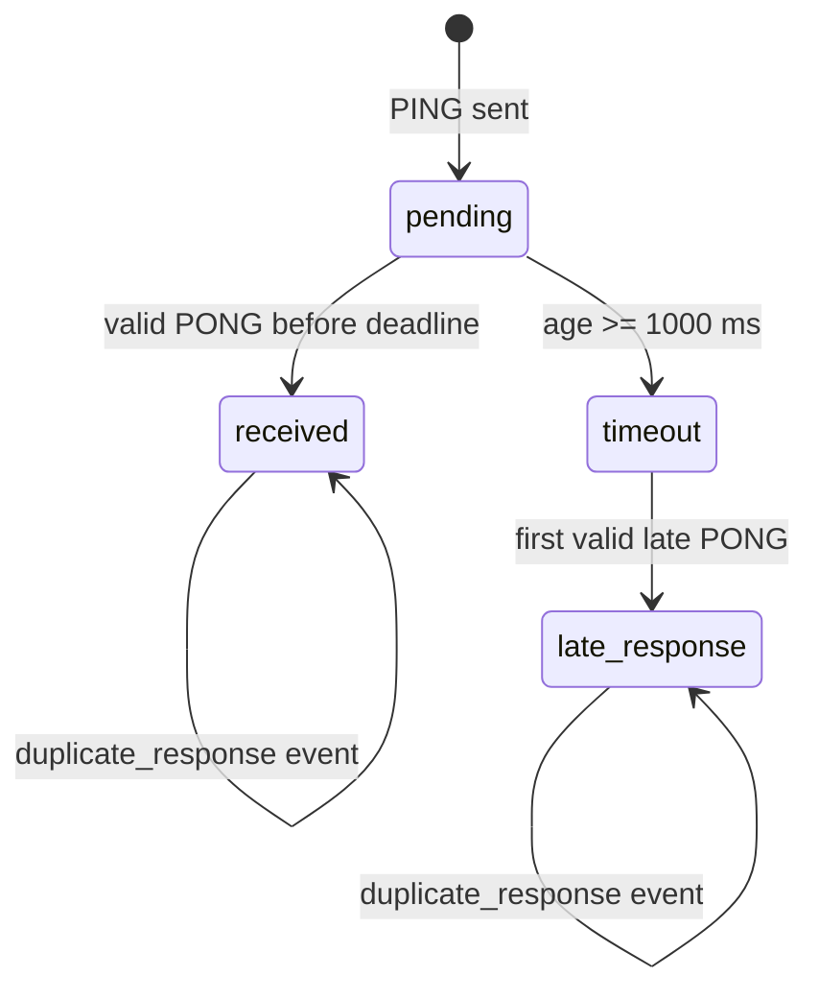

# Спецификация протокола v2

## Формат датаграммы

Бинарный заголовок занимает ровно 8 байт, без padding. Многобайтовые числа
передаются big-endian (сетевой порядок). Структуры не копируются через memcpy.

| Смещение | Поле | Тип | Размер |
|---:|---|---|---:|
| 0 | packetType | uint8 | 1 |
| 1 | sequenceNumber | uint16 | 2 |
| 3 | payloadSize | uint16 | 2 |
| 5 | protocolVersion = 2 | uint16 | 2 |
| 7 | requiresAck (0/1) | uint8 | 1 |
| 8 | payload | по типу | payloadSize |

| Тип | Код | Payload | Полная длина |
|---|---:|---|---:|
| PING | 1 | clientSendTimeUs: uint64 | 16 |
| PONG | 2 | clientSendTimeUs, serverReceiveTimeUs, serverSendTimeUs: 3 × uint64 | 32 |
| MOVEMENT | 3 | 8 байт данных команды; без ACK | 16 |
| SHOOT | 4 | пусто; requiresAck=1 | 8 |
| ACK | 5 | acknowledgedSequence: uint16; requiresAck=0 | 10 |

Времена — микросекунды steady_clock относительно неопределённой монотонной
эпохи на соответствующем компьютере. RTT = clientReceiveUs-clientSendUs;
серверные часы в RTT не участвуют. Их разность показывает время обработки.

Пример PING sequence=0x1234, time=0x0102030405060708:
`01 12 34 00 08 00 02 00 01 02 03 04 05 06 07 08`.

## Валидация

До чтения payload проверяются: ненулевой указатель и минимум 8 байт,
известный packetType, protocolVersion=2, точная ожидаемая длина payload,
полное совпадение длины датаграммы с 8+payloadSize. Лишние байты запрещены.
ReadU16/ReadU64 работают только внутри переданного диапазона одного буфера;
при нехватке байт возвращают nullopt и не сдвигают cursor.
ParsePing/ParsePong/ParseAck возвращают nullopt; outHeader при ошибке не меняется.
PONG дополнительно требует serverSendTimeUs >= serverReceiveTimeUs.

Сервер отбрасывает неверные датаграммы и пишет invalid_packet с причиной:
short_header, unknown_type, unsupported_version, payload_size_mismatch, invalid_requires_ack,
expected_ping. Клиент принимает только PONG от настроенного IP:port;
некорректные ответы дают invalid_response, чужой адрес — foreign_response.

## Сопоставление и состояния

sample — номер измерения в серии с 1; sequence — uint16 с 0 и оборотом после 65535.
Telemetry хранит до 1024 записей: sequence, sentAtUs, experimentId, status,
attempts=1, sample и опциональные RTT/SRTT. Повторных передач нет.
Время регистрации должно строго увеличиваться. Ответ сопоставляется по
sequence и echoed clientSendTimeUs; несовпадение метки не завершает запрос.

Неизвестный/вытесненный sequence даёт unknown_response. Неверная метка или
приём раньше времени отправки даёт invalid_response. Эти события не меняют
RTT/SRTT/jitter/loss. При позднем ответе после timeout потеря сохраняется;
если таймер ещё не обработан, сначала создаётся timeout, затем late_response.
Завершённые записи вытесняются в порядке регистрации; pending не вытесняется.
Полностью занятая pending история отклоняет регистрацию исключением.

## CSV

Разделитель `;`, десятичная точка, шесть знаков после неё, одна строка заголовка:
`experiment_id;sample;sequence;sent_at_ms;rtt_ms;srtt_ms;status;observed_at_ms`.
Время относительно старта серии; только received содержит RTT/SRTT.
На каждый успешно отправленный PING — одна итоговая received или timeout.
Диагностические события пишутся дополнительно; sample=0 означает отсутствие
сопоставленного измерения. CSV рассчитан на одного писателя.
При запуске в существующий файл проверяется заголовок. Для новой серии
используйте уникальный experiment_id, для повторного эксперимента — новую папку.

## Надёжная доставка ПР3

SHOOT имеет requiresAck=1, остальные типы — 0. Другие комбинации флага
отбрасываются. ACK никогда не подтверждается. Например ACK с собственным
sequence=9 для SHOOT 0x1234: `05 00 09 00 02 00 02 00 12 34`.

ReliableChannel хранит исходные байты и повторяет их по RTO. ACK снимает
pending-запись; duplicate/unknown/late ACK игнорируются. Сервер отвечает
на повтор, но окно 1024 номера предотвращает повторное применение выстрела.
После 5 отправок и ожидания последнего RTO выдаётся failed.
Алгоритм, ограничения сессии и результаты: [Reliability_Protocol.md](Reliability_Protocol.md).

PING/PONG и расчёт метрик ПР2 сохранены. Исторический CSV ПР2 измерен на v1;
текущие клиент и сервер используют v2, пакет v1 отклоняется по версии.
Адрес по умолчанию: 127.0.0.1:27015, IPv4.
