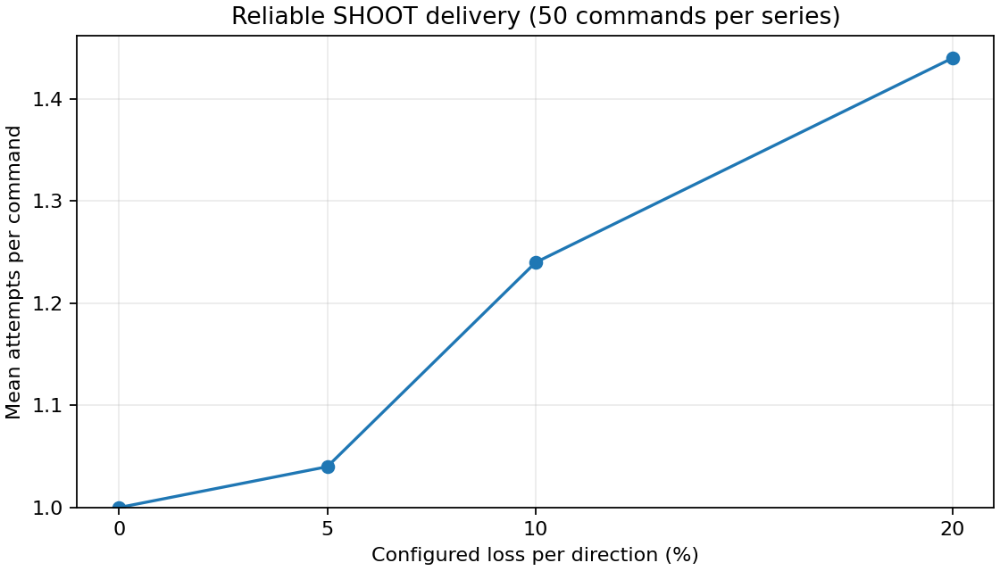
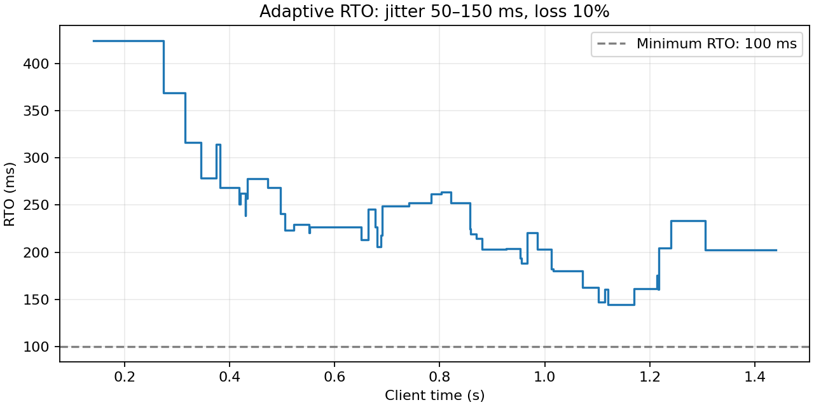

# ПР3: надёжная доставка поверх UDP

## Состав команды
Артём Лаптев (GitHub: Copilot82).

## Как запустить
```bash
python3 run3.py
```
Из корня репозитория. Собираются C++-программы, запускаются сервер и клиент,
отправляются 10 SHOOT при 20% потерь в каждом направлении. Процессы завершаются автоматически.
Для отдельного запуска: `build-pr3/reliable_server 127.0.0.1 27015 loss_20 20261027` и
`build-pr3/reliable_client 127.0.0.1 27015 manual 50 20 samples.csv 5`.

## Архитектура и алгоритм
- `protocol` — ручная сериализация и проверка формата v2: 8-байтный заголовок, requiresAck, ACK.
- `telemetry` — PING/PONG и общий RttEstimator для сглаживания RTT.
- `reliability` — ReliableChannel, AdaptiveTimeout и ReceiveWindow; сокетов в модуле нет.
- `transport` — UDP-сокеты; reliable_client/reliable_server соединяют модули.
- SHOOT надёжен (requiresAck=1): потеря выстрела меняет игру. MOVEMENT ненадёжен: новая позиция заменяет старую.
- ACK имеет payload из uint16 acknowledgedSequence. ACK/PING/PONG не требуют ACK.
- Неподтверждённый SHOOT хранится с исходными байтами, первой/последней отправкой и числом попыток.
- По истечении RTO пакет отправляется снова. Максимум 5 отправок включая первую; после последней ждём полный RTO и фиксируем failed.
- Дублирующие, неизвестные и поздние ACK не меняют завершённый результат.
- На сервере окно 1024 номера на каждый IP:port: повтор получает ACK без второго выстрела; слишком старый пакет отбрасывается.
- В одном клиентском запуске до 65536 команд без переиспользования sequence. Новый запуск использует новый UDP-порт.
- Пределы: 1024 pending в менеджере, 512 одновременно в клиенте, 128 серверных сессий и 4096 отложенных ответов.

## Адаптивный тайм-аут
Первый образец: SRTT=RTT, RTTVAR=RTT/2. Далее:
```text
RTTVAR = 0.75 * RTTVAR + 0.25 * abs(previous_SRTT - RTT)
SRTT   = 0.875 * previous_SRTT + 0.125 * RTT
RTO    = clamp(SRTT + 4 * RTTVAR, 100, 3000) мс
```
До первого образца RTO=1000 мс. SRTT рассчитывает RttEstimator из telemetry.
Образцы поступают от валидных PONG (проверяются номер и эхо времени) и ACK первой отправки.
Правило Karn: ACK после повторной отправки завершает доставку, но не обновляет RTT: неизвестно, на какую попытку пришёл ответ.
Время до ACK в CSV измеряется от первой отправки, даже после повторов. Часы монотонные, только клиентские.

## Конфигурация эксперимента
Дата: 2026-10-27T05:34:15.620509-07:00. ОС: macOS-26.4.1-arm64-arm-64bit; компилятор: AppleClang 17.0.0.17000603.
Измеряемый коммит: `7c26f731717c49ebbc6c609f8257df0b8ac2f8a5`; SHA-256 бинарников сохранены в reliability_metadata.json.
Loopback 127.0.0.1, 50 команд/серия, интервал 20 мс, seed=20261027, maxAttempts=5.
Клиент начинает команды через 150 мс и посылает PING каждые 200 мс для оценки канала.
Эмулятор на сервере независимо отбрасывает входящий SHOOT и исходящий ACK с указанной вероятностью.
Задержка применяется один раз к ответу: 100 мс либо равномерно 50–150 мс. PONG также проходит эмуляцию ответа.
Потеря ACK вызывает повтор уже применённого выстрела: окно предотвращает повторный эффект.
Воспроизведение:
```bash
python3 -m venv .venv
.venv/bin/python -m pip install -r pr2-latency-template/requirements.txt
.venv/bin/python pr2-latency-template/scripts/reliability_experiments.py --build-dir build-pr3-run --output-dir results-pr3
```
На Windows: `.venv/Scripts/python.exe`. Графики требуют matplotlib; демонстрация run3.py — только стандартную библиотеку Python.

## Результаты
| Серия | Команд | ACK с 1-й попытки | Повторов | Failed | Ср. попыток | Ср. RTO, мс | Конечный RTO, мс | До ACK, мс |
|---|---:|---:|---:|---:|---:|---:|---:|---:|
| baseline | 50 | 50 (100%) | 0 | 0 (0%) | 1.000 | 100.000 | 100.000 | 0.298 |
| loss_5 | 50 | 48 (96%) | 2 | 0 (0%) | 1.040 | 100.000 | 100.000 | 4.343 |
| loss_10 | 50 | 40 (80%) | 12 | 0 (0%) | 1.240 | 100.000 | 100.000 | 24.466 |
| loss_20 | 50 | 34 (68%) | 22 | 0 (0%) | 1.440 | 100.000 | 100.000 | 44.532 |
| delay_100_loss_5 | 50 | 48 (96%) | 2 | 0 (0%) | 1.040 | 113.265 | 102.095 | 105.719 |
| jitter_loss_10 | 50 | 41 (82%) | 13 | 0 (0%) | 1.260 | 223.400 | 202.251 | 154.212 |

Средний RTO — среднее его значение при завершении команд; до ACK — среднее только подтверждённых команд.

## Графики




## Анализ
При малом RTT RTO опускается до 100 мс, поэтому потери восстанавливаются быстрее фиксированного ожидания 1000 мс из ПР2.
RTTVAR растёт при колебаниях задержки, повышая RTO и уменьшая число преждевременных повторов.
В loss_20 получено ACK для 50 из 50 команд; failed=0, повторных отправок=22.
Потери в обоих направлениях означают вероятность успешной попытки (1-p)^2; фактические доли на 50 командах отличаются от заданных вероятностей.
failed означает отсутствие подтверждения: команда могла быть выполнена, если потерялись все её ACK. Приложение сообщает «выстрел не подтверждён», не создаёт новый выстрел автоматически.
Сервер считает игровые эффекты; эксперимент дополнительно проверяет, что один номер применён не более одного раза.
Loopback с программной эмуляцией не описывает интернет: абсолютные времена зависят от планировщика ОС, порядок сетевых событий может менять расход seeded RNG.

## Что сказать на защите
UDP сам не гарантирует доставку. Я добавил ACK и повторные отправки для SHOOT. Клиент хранит неподтверждённые команды,
а сервер запоминает номера уже обработанных выстрелов. Поэтому потеря ACK приводит к повтору пакета, но не к повторному выстрелу.
Тайм-аут зависит от SRTT и разброса RTT из ПР2. После пяти неудачных отправок приложение получает событие failed.
ACK не подтверждается, чтобы не возникала бесконечная цепочка. MOVEMENT остаётся ненадёжным, потому что старую позицию заменяет новая.

Исходные события: reliability_samples.csv; агрегаты: reliability_summary.json; параметры и хеши: reliability_metadata.json.
